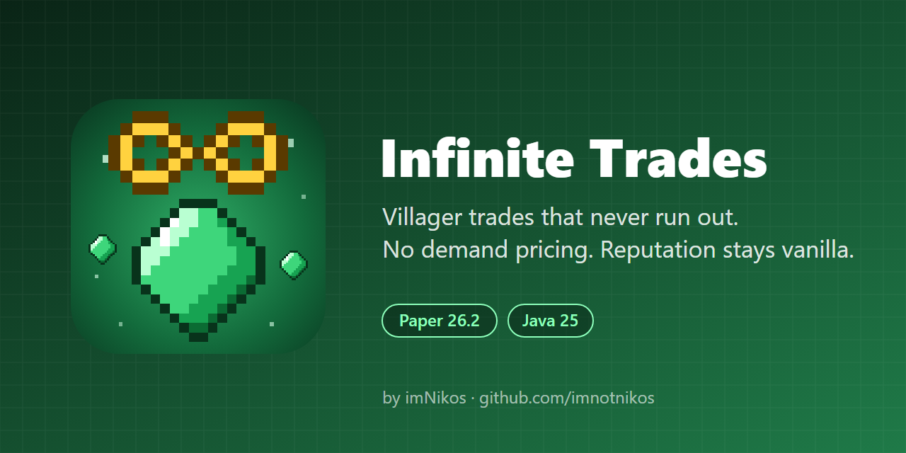

<p align="center"></p>

# Infinite Trades
Infinite Trades is a lightweight **Paper** plugin for 26.2 that makes villager trading painless without breaking vanilla reputation. Trades restock instantly and never run out, and prices no longer climb just because a trade gets used a lot.


***
### Plugin made by imNikos.
 
[](https://discord.gg/9xJgzNqEaJ)
[](https://instagram.com/imnikos_)
[](https://youtube.com/@imnikoss)
[](https://tiktok.com/@imnikos_)
[](https://github.com/imnotnikos)
[](https://modrinth.com/user/imNikos)
[](https://www.curseforge.com/members/imnotnikos/projects)

***

## Features
**Infinite Stock**: Trades restock instantly and never lock with the red X.

**No Demand Pricing**: The vanilla "demand" price increase from trading a lot is removed.

**Vanilla Reputation**: Hitting a villager still raises its prices, and curing a zombie villager still gives the big discount.

**Wandering Traders**: Optionally give wandering traders infinite stock too.

**Per-World Control**: Turn the plugin off in any world from the config.

## Commands

/infinitetrades reload – Reloads config.yml.

/infinitetrades status – Shows the current settings.

_Available aliases:_ /itrades

## Permissions
infinitetrades.admin : Required to use the commands (default: op). Regular players don't need any permissions to trade.

## Configuration
```yaml
infinite-stock: true
remove-demand-pricing: true
include-wandering-traders: true
disabled-worlds: []
```

## Requirements
A Minecraft server running **Paper 26.2**.

Java 25.

# Installation
## For Server Owners
Navigate to the Releases page.

Download the latest InfiniteTrades jar.

Place the file into your server's /plugins/ directory.

Restart your server.

## Building
Requires JDK 25 and Maven.

    mvn package

Output: `target/InfiniteTrades-1.0.0.jar`
